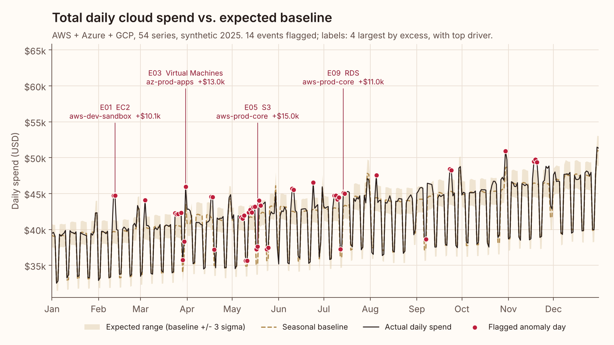
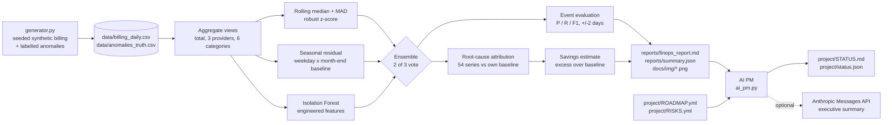
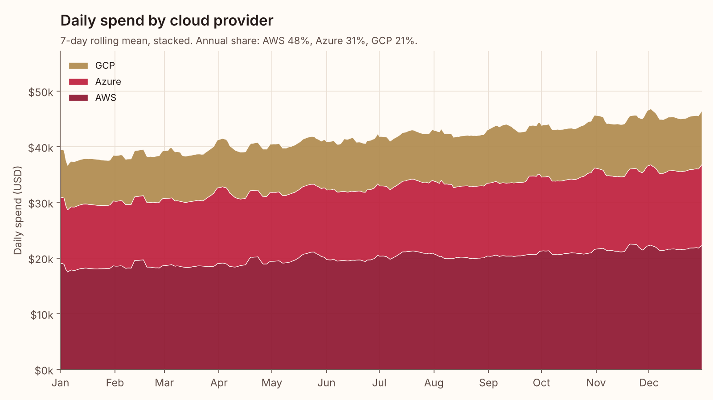
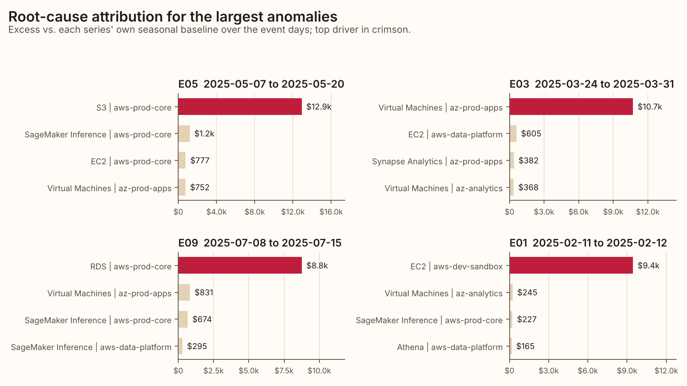
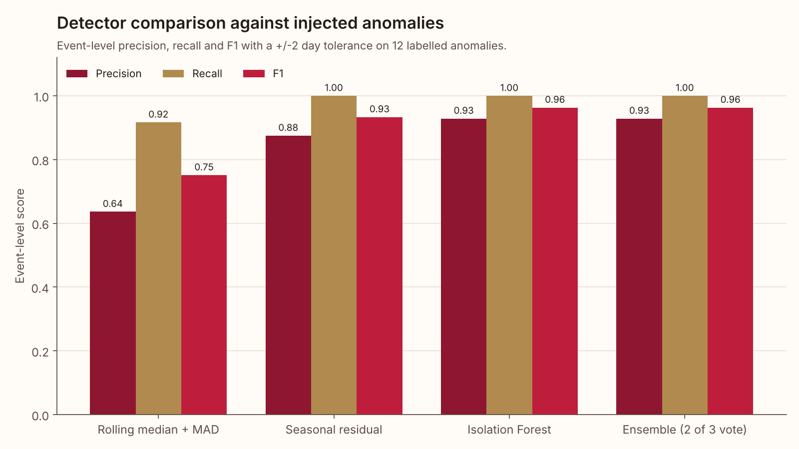

# Cloud Cost Anomaly Radar

**Find multi-cloud spend spikes, name the service and account that caused them, and size the dollars at stake.**

[](https://github.com/laurenbmcguire/cloud-cost-anomaly-radar/actions/workflows/ci.yml)


[](project/STATUS.md)



> Portfolio project. All billing data is synthetic and generated by a seeded generator in this repo (see [Data](#data)).

## Why it matters

- **Cloud bills move faster than budget reviews.** A sandbox GPU fleet or a retry storm can burn thousands of dollars before a monthly review sees it. Daily detection shortens that window to a day.
- **An alert without a cause becomes noise.** Each flag here ships with a ranked list of the provider, account and service that drove the increase, so the right owner gets the alert.
- **FinOps needs a dollar figure to prioritise.** Every event carries an excess-over-baseline estimate, which turns "spend looks odd" into "this cost $15k over two weeks".

## What it does

- **Synthetic multi-cloud billing generator**: 365 days x 3 providers (AWS, Azure, GCP) x 3 accounts x 6 services (compute, storage, database, networking, AI/ML inference, analytics) = 54 daily series with growth trend, weekly seasonality, month-end batch effects, AR(1) noise, 2 planned (expected) events and 12 injected, labelled anomalies (spikes, level shifts, slow leaks).
- **Three detectors and an ensemble**: rolling median + MAD robust z-score, seasonal residual scoring, and scikit-learn `IsolationForest` on engineered features. The ensemble flags a day when 2 of 3 detectors agree.
- **Event-level evaluation**: precision, recall and F1 against the injected labels with a +/-2 day tolerance, plus a robustness check on four other generator seeds.
- **Root-cause attribution**: for each event, every one of the 54 series is compared with its own seasonal baseline and ranked by dollar delta, with rollups by provider, service and account.
- **Savings estimate**: dollar excess over baseline per event, compared with the injected ground truth.
- **Outputs**: a FinOps report in [`reports/finops_report.md`](reports/finops_report.md), machine-readable [`reports/summary.json`](reports/summary.json) and four charts in `docs/img/`.
- **AI Project Manager**: reads the roadmap, risks and the latest results and writes a weekly [`project/STATUS.md`](project/STATUS.md).

## Architecture



## Results on the sample data

Seed 42, 365 days, $15.24M total synthetic spend ($41.8k per day). Numbers are copied from `reports/summary.json`.

| Detector | Precision | Recall | F1 | Events | Flagged days | Mean F1, 4 other seeds |
|---|---|---|---|---|---|---|
| Rolling median + MAD | 0.64 | 0.92 | 0.75 | 22 | 57 | 0.77 |
| Seasonal residual | 0.88 | 1.00 | 0.93 | 16 | 75 | 0.91 |
| Isolation Forest | 0.93 | 1.00 | 0.96 | 14 | 25 | 0.92 |
| **Ensemble (2 of 3 vote)** | **0.93** | **1.00** | **0.96** | **14** | **47** | **0.94** |

| Outcome | Value |
|---|---|
| Injected anomalies detected | 12 of 12 |
| False-positive events | 1 (the planned disaster-recovery failover test, P01) |
| Root cause ranked first correctly | 12 of 12 detected anomalies |
| Estimated excess, all 14 events | $96,432 |
| Estimated vs injected excess on detected anomalies | $92,693 vs $142,213 (65% captured) |
| Largest event | E05, AWS S3 in `aws-prod-core` (slow leak), $15,016 excess |
| Pipeline runtime | about 4 s in a local run, including the four robustness re-runs |

What the numbers say, plainly:

- On seed 42 the ensemble and Isolation Forest tie on F1 (0.96). Across four other seeds the ensemble has the highest mean F1 (0.94 vs 0.92) because the vote absorbs each detector's bad days.
- The naive rolling baseline catches most anomalies but raises 8 false events; 7 of them are month-end analytics batch runs it has no model for. The seasonal detector's 2 false events are both planned events. That gap is the case for modelling seasonality.
- The savings estimate is deliberately conservative. The baseline is causal, so level shifts and slow leaks are only counted on the days they are flagged; 65% of the injected dollars are captured.
- The one false positive is an approved event. A change calendar (backlog B17) would suppress it.

| Spend by provider | Root-cause attribution |
|---|---|
|  |  |



## AI Project Manager

`src/costradar/ai_pm.py` manages this repo as a project. It reads [`project/ROADMAP.yml`](project/ROADMAP.yml), [`project/RISKS.yml`](project/RISKS.yml) and `reports/summary.json`, then writes [`project/STATUS.md`](project/STATUS.md) and `project/status.json`. A GitHub Actions workflow runs it every Monday and commits the result.

The deterministic engine always runs:

- **Health RAG** with explicit rules: RED if any milestone is overdue or more than one P0 item is open; AMBER if one P0 item is open or any open risk scores 15 or more (probability x impact); GREEN otherwise.
- **Milestones** with % done from linked backlog items.
- **Risk register** sorted by score with a heat label (Critical >= 20, High >= 15, Medium >= 8, Low).
- **Next 3 actions**: unblocked `todo` items ranked by priority, then by dependencies satisfied.
- **What the data says**: 3-5 bullets built from `summary.json`, so the status reflects what the analysis actually found.
- **Decision / change log** entry.

Snippet from the committed [`project/STATUS.md`](project/STATUS.md):

```text
**Health: AMBER**: 0 overdue milestone(s), 0 open P0 item(s), 1 open risk(s) scored >= 15 (R1=16).

## Next 3 actions
| # | ID  | Action                                                      | Priority | Owner  | Depends on |
| 1 | B15 | Alert payload schema (event, driver, excess, runbook link)  | P1       | AI PM  | B07, B08   |
| 2 | B17 | Change-calendar suppression for planned events              | P1       | Lauren | B02, B06   |
| 3 | B12 | Seasonal-naive and Holt-Winters 30-day forecast baseline    | P1       | Lauren | B04        |

## What the data says
- The ensemble flagged 14 events: precision 0.93, recall 1.00, F1 0.96 against 12 injected anomalies; none missed.
- Root-cause attribution ranked the injected series first for 12 of 12 detected anomalies (100%).
```

**LLM mode (optional).** If `ANTHROPIC_API_KEY` is set, the PM sends the computed facts JSON to the Anthropic Messages API (`https://api.anthropic.com/v1/messages`, standard-library `urllib`, model from `AI_PM_MODEL`, default `claude-sonnet-4-5`) and asks for a 90-120 word executive summary grounded only in those facts. If there is no key, the call fails, or the reply is empty or the wrong length, it falls back to a deterministic template. The LLM never decides health, priorities or numbers, and tests never touch the network. In the workflow the key comes from an optional repository secret.

## Quickstart

```bash
git clone https://github.com/laurenbmcguire/cloud-cost-anomaly-radar.git
cd cloud-cost-anomaly-radar
pip install -e .
python -m costradar run      # generate data if missing, detect, attribute, chart, report
python -m costradar pm       # AI PM status -> project/STATUS.md
pip install pytest && pytest -q
```

Useful flags: `python -m costradar run --regenerate --seed 7` (new synthetic year), `--no-robustness` (skip the extra seeds), `python -m costradar pm --today 2026-11-02 --no-llm` (reproducible status). The `costradar` console script is installed too.

## Project structure

```text
cloud-cost-anomaly-radar/
├── src/costradar/
│   ├── generator.py      # seeded billing generator, anomalies, planned events
│   ├── detectors.py      # rolling MAD, seasonal residual, Isolation Forest, ensemble
│   ├── evaluation.py     # event grouping and event-level P/R/F1 with tolerance
│   ├── attribution.py    # per-series baselines, root-cause ranking, excess estimate
│   ├── pipeline.py       # end-to-end run and summary.json
│   ├── report.py         # Markdown FinOps report
│   ├── charts.py         # matplotlib charts
│   ├── style.py          # brand chart style
│   ├── ai_pm.py          # AI Project Manager
│   └── cli.py            # `run` and `pm` commands
├── tests/                # 22 pytest tests
├── examples/             # small committed samples of the generated data
├── data/                 # full generated dataset (git-ignored, rebuilt on demand)
├── docs/img/             # charts produced by the pipeline
├── reports/              # finops_report.md, summary.json
├── project/              # ROADMAP.yml, RISKS.yml, STATUS.md, status.json
└── .github/workflows/    # ci.yml, ai-pm.yml
```

## Methodology

**Monitors.** The statistical detectors score 10 views of daily cost: the total, each provider (3) and each service category (6). A day's score is the maximum upward score across views, so a spike that is small in the grand total but large inside one category still registers. Thresholds are set at 4.5 rather than 3 to absorb the multiple comparisons. Only increases are flagged; drops are usually data latency, not waste. The first 21 days are a warm-up.

**1. Rolling median + MAD.** For each view, using only the previous 28 days:

$$z_t = \frac{x_t - \operatorname{median}(x_{t-28..t-1})}{1.4826 \cdot \operatorname{MAD}(x_{t-28..t-1})}, \qquad \text{flag if } z_t \ge 4.5$$

**2. Seasonal residual.** Weekday factors $w_d$ and a month-end factor $m$ (last two days of the month) come from median ratios to a centred 15-day rolling median. The causal baseline is

$$\hat{x}_t = L_t \cdot w_{d(t)} \cdot m_t, \qquad L_t = \operatorname{median}\left(\frac{x_{t-21..t-1}}{w \cdot m}\right)$$

and the score is the relative residual $r_t = (x_t - \hat{x}_t)/\hat{x}_t$ standardised by its median and global MAD; flag if the score is 4.5 or more.

**3. Isolation Forest.** 300 trees on robust-scaled features: seasonal relative residual, ratio to the trailing 28-day median, day-over-day and week-over-week change, and the deviation of each provider's and category's share of spend from its trailing median. The anomaly score is $-$`score_samples`; the top 8% of days (after warm-up) are flagged when spend is above baseline.

**Ensemble.** Flag a day when at least 2 of 3 detectors flag it. Flagged days separated by at most one quiet day form one event. The ensemble score (mean of each detector's score divided by its threshold) ranks severity.

**Evaluation.** A predicted event is a true positive if it overlaps a labelled window widened by 2 days on each side. Precision = true-positive events / predicted events; recall = labelled anomalies hit / 12; $F_1 = 2PR/(P+R)$. Detector settings were chosen on a small grid across five generator seeds and are reported unchanged on seed 42; the robustness column above re-runs the other four seeds.

**Attribution.** Each of the 54 series gets its own seasonal baseline. For event days $E$, $\Delta_s = \sum_{t \in E} (x_{s,t} - \hat{x}_{s,t})$; series are ranked by $\Delta_s$ and their share is $\Delta_s / \sum_{\Delta_j > 0} \Delta_j$. Rollups sum $\Delta_s$ by provider, service and account.

**Savings.** Excess for an event is $\sum_{t \in E} \max(x_t - \hat{x}_t, 0)$ on total spend. It is compared with the exact injected dollars recorded by the generator.

## Data

All data in this repository is **synthetic**. `src/costradar/generator.py` builds it from a fixed seed (42 by default): base levels by provider, account type and service, compound growth (fastest for AI/ML), weekend dips for non-production accounts, month-end batch uplift, AR(1) log-normal noise, two planned events and 12 injected anomalies whose exact dollar impact is saved as ground truth. Account names such as `aws-prod-core` are invented. No real billing export, company, customer or user is represented, and the accuracy figures describe performance on this synthetic data only. The full dataset (19,710 line items, about 1.1 MB) is rebuilt on demand in `data/`; small samples are committed in [`examples/`](examples/).

## Roadmap

From [`project/ROADMAP.yml`](project/ROADMAP.yml):

| ID | Milestone | Due | Status |
|---|---|---|---|
| M1 | Synthetic multi-cloud billing generator | 2026-10-19 | done |
| M2 | Detector ensemble and evaluation | 2026-10-26 | done |
| M3 | Root-cause attribution and savings estimate | 2026-10-30 | done |
| M4 | FinOps report, charts and AI PM | 2026-11-02 | done |
| M5 | Cost-forecast extension (30-day forecast, backtested MAPE, budget-breach warning) | 2026-12-14 | planned |
| M6 | Slack alert integration (driver, excess, runbook link; planned-event suppression) | 2027-01-25 | planned |

Top risks tracked in [`project/RISKS.yml`](project/RISKS.yml): alert fatigue (score 16), billing data latency, tag hygiene, synthetic data overstating real accuracy, and structural changes such as migrations and commitment purchases.

## Author

**Lauren McGuire**, AI & Cloud Architect
[laurenmcguireresume.com](https://laurenmcguireresume.com) · [LinkedIn](https://www.linkedin.com/in/laurenbmcguire)
